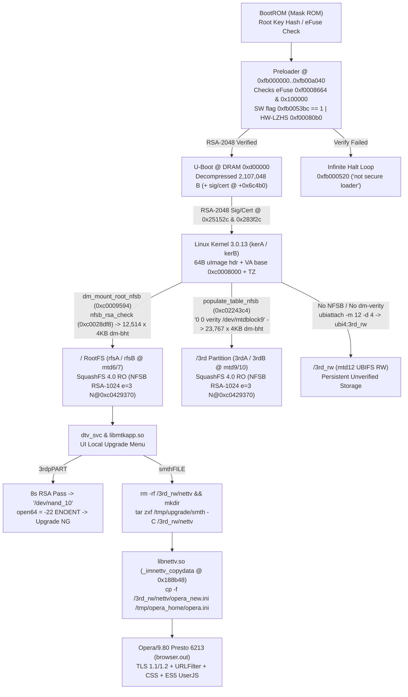

# Cryptographic Chain-of-Trust Analysis, Container Reverse Engineering, and Lock-Compliant Firmware Customization on the MediaTek MT5880 / TPV MTK2K14PLF Embedded Television Platform (`AOC LE32S5760/20`)

[](#verification-summary--epistemic-boundaries)
[](docs/01_architecture_hardware_and_flash_layout.md)
[](docs/02_secure_boot_chain_preloader_tz_and_nfsb.md)
[](docs/02_secure_boot_chain_preloader_tz_and_nfsb.md)
[-success)](docs/05_mtd12_rw_delivery_and_offline_verification_thesis.md)
[](LICENSE)

---

## Abstract

This repository presents a monograph-length reverse-engineering investigation and deterministic cryptographic verification suite examining the embedded Linux Smart TV firmware architecture of the **AOC LE32S5760/20** (`TPV MTK2K14PLF` chassis family, **MediaTek MT5880** dual-core ARMv7-A SoC, Linux `3.0.13` kernel, DirectFB `1.4.1`, Qt `4.8.3`). Prompted by empirical upgrade failures observed when attempting to flash modified SquashFS images or factory PKG packages onto retail television hardware — specifically an **8-second progress stall (`...`) followed by abort dialog `"REINICIAR OU TENTAR NOVAMENTE"`** — and by engineering questions regarding modern streaming/browser compatibility (Netflix, Chromium, YouTube) on 2014–2016 CE silicon, this study reconstructs and proves the end-to-end enforcement pipeline from mask-ROM silicon up to Qt and Opera userland processes.

Across nine detailed chapters and appendices backed by **seven standalone Python/Shell proof scripts** (`scripts/`), we establish formal, instruction-verified explanations for every major security and execution boundary on the target platform:

1. **Silicon-to-Userspace Chain of Trust:** From BootROM through the Thumb-2 Preloader (`extracted/uboot.bin`), hardware **eFuse gate (`0xf0008664 & 0x100000`)**, software flag `[0xfb0053bc] == 1`, proprietary **HW-LZHS (`0xf00080b0`)** decompression block, dual RSA-2048 signature/certificate trailers inside `kerA`/`kerB`, down to the Linux kernel `dm-verity` **`NFSB` v2 raw RSA-1024 (`e = 3`)** block-integrity layer.
2. **`uImage` Virtual Offset Alignment & Complete Merkle-Tree Verification:** By identifying a `64`-byte `uImage` header (`magic = 0x27051956`, `load = 0x00007fc0`, `ep = 0x00008000`) at the head of decompressed `scratch/vmlinux.bin`, all kernel virtual addresses and `.rodata` string pointers align bit-for-bit (`N @ 0xc0429370`, `e = 3 @ 0xc04292f0`, `nfsb_rsa_check @ 0xc0028df8`, `dm_mount_root_nfsb @ 0xc0009594`, `populate_table_nfsb @ 0xc02243c4`). We verify both the textbook RSA-1024 equations across all four factory partitions (`3rdB`, `3rdA`, `rfsB`, `rfsA`) **and all `36,281` individual 4 KB SquashFS blocks (`23,767` in `3rdA`, `12,514` in `rfsA`)** through the two-level **`dm-bht` MD5 Merkle tree** up to the RSA-signed root digests (`666e1b26...` and `6cc5d821...`), accompanied by a direct failure counter-proof on `build/custom_upgrade_loader.pkg`.
3. **MTK/TPV DLM Container Cryptosystem (`Autorun.upg`) & Upgrade Engine Post-Mortem:** Disassembly of `libdtv_common.so` (`dlm_locate_codefile_hdr`, `x_dlm_download_by_tag`, `x_dlm_integrity_check`) and `libmtkapp.so` (`_phm_upg_model_*`, `sub_404f28`, `sub_407d4c`, `sub_4074c0`) resolves every layer of the `.upg` format: outer `128`-byte filename slot, AES-128-CBC envelope under hardcoded key `0x94102909 * 4` (`IV = 0`) yielding `#DH@FiRm`, zeroed-slot body `MD5`, non-standard `33`-byte (`\n`-inclusive) `MD5(AES_Prod.key/.iv)` derivation, `"reserved mtk inc"` chunk authenticator, per-chunk `SHA-256`, and raw PKCS#1 v1.5 RSA-2048 (`cmp r8, #0x20`). We pinpoint the exact causes of the 8-second failure: `<METHOD>PART</METHOD>` causes `sub_404f28` (`r6 == 0`) to format `"/dev/nand_10"` (returning `-22 ENOENT` from `c_fm_erase_flash_part` because the kernel only populates `/dev/mtd*`), and `_phm_upg_model_start_upgrade` (`0x40ae80..0x40ae9c`) explicitly skips dual-bank EEPROM toggling for standalone `3rdp` updates.
4. **Lock-Compliant Persistent Delivery on `mtd12` (`/3rd_rw`) & Application Stack Ceiling Audit:** We prove that `mtd12` (`ubi4:3rd_rw`) bypasses `NFSB`/`dm-verity`, trace `dtv_svc` (`sys_start.c @ 0x036190..0x036314`) preserving `/3rd_rw/nettv` whenever `/3rd_rw/upgrade/customer_version` exists, trace `libnettv.so` (`_imnettv_copydata @ 0x1889a0..0x188d10`) natively applying `/3rd_rw/nettv/opera_new.ini` (and managing `/mnt/browser/opcacrt6.pem`) onto `/tmp/opera_home/opera.ini`, verify the `19,905`-byte `<TAG>smth</TAG><METHOD>FILE</METHOD>` upgrade package, dissect `SystemManager` (`SMConfig` `dynqml` gate at `0x1db58c`), document why static `OpenSSL 1.0.0d` (Netflix 2015), Flash Lite (`yt_lbl.swf`), Presto `6213`, GCC `4.5.1` ABI, `512 MB` unified DRAM, and stripped BusyBox binaries prevent native Chromium/TLS 1.3 porting, and audit every bug remediated in `custom_payload/`.

---

## Core Research Theses & Empirical Conclusions

| Thesis ID | Hypothesis / Technical Question | Verified Conclusion | Primary Machine Proof |
|---|---|---|---|
| **T1** | Why did flashing a `97.38 MB` custom `Autorun.upg` (`<TAG>3rdp</TAG><METHOD>PART</METHOD>`) pass for ~8s on `...` and then abort with `"REINICIAR OU TENTAR NOVAMENTE"`? | `x_dlm_integrity_check` (`0x9a7d0`) verified the RSA-2048 signature and hashes in ~8s. `_phm_upg_model_start_upgrade` then called `sub_404f28` (`r6 == 0`), formatting `"/dev/nand_10"` (`"nand_%d"`). Because Linux exposes `/dev/mtd10` (`PMTD`), `c_fm_erase_flash_part` failed with `-22 ENOENT` (`Upgrade NG`). Additionally, `0x40ae94` (`strncmp(tag, "3rdp", 4)`) skips bank switching. | [`evidence/03_upg_installer_disasm.txt`](evidence/03_upg_installer_disasm.txt) |
| **T2** | Can a modified SquashFS (`3rdp`) or patched `upgrade_loader.pkg` (`custom_upgrade_loader.pkg`) mount on a stock kernel? | **No.** `dm_mount_root_nfsb` (`0xc0009594`) and `populate_table_nfsb` (`0xc02243c4`) enforce `nfsb_rsa_check` (`0xc0028df8`): textbook raw RSA-1024 (`e = 3`, `N @ 0xc0429370`) checking exact equality via `mpi_cmp` against `0x00^96 \|\| SHA256(hdr[0:0x67])`, guarding two-level `dm-bht` MD5 Merkle trees over all `36,281` 4 KB SquashFS blocks (`3rdA`: `23,767`, `rfsA`: `12,514`). | [`evidence/01_pkg_and_nfsb_proof.txt`](evidence/01_pkg_and_nfsb_proof.txt)<br/>[`evidence/07_dmbht_and_boot_scripts_audit.txt`](evidence/07_dmbht_and_boot_scripts_audit.txt) |
| **T3** | Can `kerA`/`kerB` or `uboot.bin` be patched over USB to disable `NFSB` without risking a hard brick? | **No.** Preloader (`0xfb001458`) checks HW eFuse `0xf0008664 & 0x100000` + SW flag `[0xfb0053bc] == 1`, invokes BootROM RSA-2048 (`0xfb0034f0`), and halts permanently (`0xfb000520` `"not secure loader"`) on mismatch; `kerA`/`kerB` append dual `[256B sig \| 256B cert]` trailers (`0x25152c`, `0x283f2c`). | [`evidence/02_secure_boot_chain_disasm.txt`](evidence/02_secure_boot_chain_disasm.txt) |
| **T4** | Is there a cryptographically authentic, zero-brick-risk customization path on locked retail firmware? | **Yes.** `mtd12` (`ubi4:3rd_rw`, `/3rd_rw`) is outside `NFSB`/`dm-verity`. `libmtkapp.so` natively admits `<TAG>smth</TAG><METHOD>FILE</METHOD><PATH>/3rd_rw/nettv</PATH>` via `rm -rf` -> non-recursive `mkdir` -> `tar zxf` (`sub_407d4c` -> `sub_4074c0`), preserving `customer_version`, while `libnettv.so` (`_imnettv_copydata`) applies `/3rd_rw/nettv/opera_new.ini` cleanly onto `/tmp/opera_home/opera.ini`. | [`evidence/04_upg_container_crypto_proof.txt`](evidence/04_upg_container_crypto_proof.txt)<br/>[`evidence/06_systemmanager_and_nettv_disasm.txt`](evidence/06_systemmanager_and_nettv_disasm.txt) |
| **T5** | Can Netflix 2015, Chromium/TLS 1.3, modern YouTube, or Python proxies operate natively on stock `rfs`/`3rd`? | **No.** `netflix` (`20150420`) links statically/against **OpenSSL 1.0.0d (Feb 2011)** (max TLS 1.0); YouTube `leanback` is Flash Lite (`yt_lbl.swf`); Opera is `Presto/9.80` (`20140526`, max **TLS 1.2** + ES5); `SystemManager` defaults to embedded `qrc:/HomeScreen/HSMain.qml` (`dynqml == 0`); BusyBox lacks `python`, `curl`, `pidof`, `pgrep`, `renice`, `ionice`, `chown`, `killall`, `unzip`. | [`evidence/05_runtime_engines_and_busybox_audit.txt`](evidence/05_runtime_engines_and_busybox_audit.txt)<br/>[`evidence/06_systemmanager_and_nettv_disasm.txt`](evidence/06_systemmanager_and_nettv_disasm.txt) |
| **T6** | Do all nine firmware ELFs and startup scripts align with GCC `4.5.1` / `DirectFB 1.4.1` and exhibit verifiable static hooks? | **Yes.** Full `DT_NEEDED` auditing across all 9 ELFs (`SystemManager`, `dtv_svc`, `libnettv.so`, `libopera_hbbtv.so`, `browser.out`, `netflix`, `wrp_leanback`, `libmtkapp.so`, `libdtv_common.so`) confirms DirectFB/CMPB/MTAL bindings, `rc.local.partial` sets `/dev/ttyMT3 115200`, `rc.local` checks EEPROM `0x2c20`/`0x2c25` ITM mode, and `autorun.sh` exports `LD_LIBRARY_PATH` (plus vendor typo `LD_RRELOAD`). | [`evidence/06_systemmanager_and_nettv_disasm.txt`](evidence/06_systemmanager_and_nettv_disasm.txt)<br/>[`evidence/07_dmbht_and_boot_scripts_audit.txt`](evidence/07_dmbht_and_boot_scripts_audit.txt) |

---

## System Trust & Delivery Architecture



---

## Monograph Structure (Chapters & Appendices)

Every section below cites verifiable byte offsets, virtual addresses, instruction traces, and computed digests captured in [`evidence/`](evidence/):

1. **[Chapter 1 — Hardware Architecture, `upgrade_loader.pkg` Anatomy, Flash Topology & BusyBox Audit](docs/01_architecture_hardware_and_flash_layout.md)**
   Characterization of the MT5880 / MTK2K14PLF hardware envelope, full 16-partition `upgrade_loader.pkg` offset table, `cfig` MTD partition mapping (`mtd1`–`mtd30`), startup script choreography (`rc.local`, `autorun.sh`, `dtv_svc`), `LD_LIBRARY_PATH` / `LD_RRELOAD` resolution order, and complete 73-tool BusyBox / `/sbin` / `/usr/bin` surface inventory.
2. **[Chapter 2 — Cryptographic Chain of Trust: BootROM, Preloader HW-LZHS, TrustZone, Kernel `NFSB` RSA-1024 & `dm-bht` Merkle Trees](docs/02_secure_boot_chain_preloader_tz_and_nfsb.md)**
   Disassembly and algebraic verification of the BootROM -> Preloader -> HW-LZHS -> U-Boot -> `kerA`/`kerB` RSA-2048 chain, resolution of the 64-byte `uImage` alignment (`0xc0007fc0` -> `0xc0008000`), exact ARM accessor reconstruction of the `0xe7`-byte `NFSB` v2 superblock, full `dm_mount_root_nfsb` and `populate_table_nfsb` traces, complete `36,281`-block `dm-bht` MD5 Merkle tree validation, Bleichenbacher `e = 3` resistance proof, and `custom_upgrade_loader.pkg` counter-proof.
3. **[Chapter 3 — Philips/TPV DLM `.upg` Cryptographic Format & `libmtkapp.so` State Machine Internals](docs/03_dlm_upg_cryptography_and_libmtkapp_internals.md)**
   Complete specification of the 5-layer `.upg` protocol, disassembly proof of `K_mtk = 0x94102909 * 4`, `#DH@FiRm`, zeroed-slot `BodyMD5`, 33-byte `\n`-inclusive `MD5(AES_Prod.key/.iv)` key/IV derivation, `"reserved mtk inc"` chunk markers, raw PKCS#1 v1.5 RSA-2048 (`cmp r8, #0x20`), instruction-level root-cause breakdown of the 8-second `/dev/nand_10` `-22 ENOENT` failure, and the hidden `3rdp` dual-bank EEPROM skip bug.
4. **[Chapter 4 — Application Stack Reverse Engineering: `SystemManager`, `libnettv.so`, Opera Presto, Netflix NRDP & Legacy Defect Post-Mortem](docs/04_systemmanager_qt_opera_presto_and_legacy_apps.md)**
   Disassembly of `SystemManager` (`main` `0x1619e4`, `SMConfig` `0x16e428`, `dynqml` gate `0x1db58c` vs `0x1db7a4`), `dtv_svc` `customer_version` provisioning FSM, `libnettv.so` (`_imnettv_copydata` `0x1889a0..0x188d20` handling `/mnt/browser/opcacrt6.pem` & `/3rd_rw/nettv/opera_new.ini`), binary forensics of Opera Presto `6213`, Netflix `nrd-app` (`OpenSSL 1.0.0d`), Flash Lite `leanback`, Ginga SBTVD, Spotify, PlayReady/Widevine DRM plugins, and post-mortem of remediated JS/CSS/INI/Shell/QML defects.
5. **[Chapter 5 — Lock-Compliant `/3rd_rw` (`mtd12`) Delivery Architecture & Offline Verification Thesis](docs/05_mtd12_rw_delivery_and_offline_verification_thesis.md)**
   Four formal brick-safety invariants (`I1..I4`), instruction-level trace of `METHOD=FILE` (`sub_407d4c` and `sub_4074c0`), non-recursive `mkdir` & `/ro_data/smarthome/` `busybox unzip` vs `tar zxf` gating, key-by-key delta between stock `opera.ini` and `opera_new.ini`, complete breakdown of the verified `19,905`-byte `Autorun.upg` deliverable, USB staging remediation, and strict epistemic validation table.
6. **[Chapter 6 — Reproducible Experimental Protocol, Script Reference & Hardware Research Guidelines](docs/06_reproduction_guide_and_experimental_protocol.md)**
   Reproducibility toolchain dependencies, IP/key security hygiene, complete CLI usage matrix across all seven verification/disassembly scripts + container builder, passive `/dev/ttyMT3 115200 8N1` UART and eFuse `0xf0008664` diagnostic guidelines, and formal glossary.
7. **[Chapter 7 — ELF32 Dynamic Linking Topology, Memory Segment Maps & Startup Script Forensics](docs/07_elf_abi_memory_maps_and_startup_scripts.md)**
   Full section/program header and `DT_NEEDED` dynamic dependency analysis across all 9 core ELFs, forensic walkthrough of `rc.local.partial`, `rc.local` (EEPROM `0x2c20`/`0x2c25` ITM checks and boot flags), `dmverity_mount_3rda/b.sh`, `ubi_mount_3rd_rw/perm/ro_data.sh`, and `autorun.sh`.
8. **[Appendix A — Verified Cryptographic, Binary, `dm-bht` & Configuration Evidence](docs/08_appendix_verified_cryptographic_and_binary_evidence.md)**
   Complete annotated reproduction and cross-reference of primary machine outputs from `01_pkg_and_nfsb_proof.txt`, `04_upg_container_crypto_proof.txt`, `05_runtime_engines_and_busybox_audit.txt`, `07_dmbht_and_boot_scripts_audit.txt`, `urlfilter.ini`, `user.css`, `opera_new.ini`, and `leanback/config.ini`.
9. **[Appendix B — Annotated ARMv7 / Thumb-2 Primary-Source Instruction Reference](docs/09_appendix_annotated_arm_and_thumb_disassembly.md)**
   Structured, column-annotated instruction listings from `02_secure_boot_chain_disasm.txt`, `03_upg_installer_disasm.txt`, and `06_systemmanager_and_nettv_disasm.txt` linking register transfers, GOT/PC-relative literal pools, and control-flow decisions back to Chapters 2–5.
10. **[Chapter 10 (Technical Study) — Opera Presto TLS, URLFilter, Safe CSS, ES5 UserJS Polyfills & QML Overlay Feasibility](docs/10_opera_presto_tls_userjs_and_qml_study.md)**
   Exact engineering specification of `opera_new.ini` ciphers, Presto security URLFilter paths vs ad exclusions, `op[code=...]` remote CSS rules, idempotent ES5 `SimplePromise` / `fetch` / portal-scoped UA shims (`user.js`, `601` lines), and Latin-1 / brace / font audit across all 18 `qml_HomeScreen` study views.
11. **[Chapter 11 — Legacy Streaming, Hardware DRM Modules & Read-Only/Read-Write RootFS Bridging](docs/11_legacy_streaming_drm_and_rootfs_subsystems.md)**
   Analysis of MediaTek's factory `3rd_rw_list.txt` symlink architecture (`netflix`, `widevine/keybox`), Flash Lite `stagecraft` (`wrp_leanback`, `config.ini`, `yt_lbl.swf`), `PlayReady`, `Smooth Streaming` (`SSPK`), `MPEG-DASH`, `dialserver`, `dlna`, and Brazilian `Ginga` SBTVD integration.

---

## Repository Directory Map

```text
.
├── README.md
├── LICENSE
├── .gitignore                                          # Excludes *.pem, *.key, *.iv, *.pkg, *.upg, *.bin, *.squashfs, extracted/
├── docs/                                               # Monograph chapters & annotated technical appendices (3,000+ lines)
│   ├── 01_architecture_hardware_and_flash_layout.md
│   ├── 02_secure_boot_chain_preloader_tz_and_nfsb.md
│   ├── 03_dlm_upg_cryptography_and_libmtkapp_internals.md
│   ├── 04_systemmanager_qt_opera_presto_and_legacy_apps.md
│   ├── 05_mtd12_rw_delivery_and_offline_verification_thesis.md
│   ├── 06_reproduction_guide_and_experimental_protocol.md
│   ├── 07_elf_abi_memory_maps_and_startup_scripts.md
│   ├── 08_appendix_verified_cryptographic_and_binary_evidence.md
│   ├── 09_appendix_annotated_arm_and_thumb_disassembly.md
│   ├── 10_opera_presto_tls_userjs_and_qml_study.md
│   └── 11_legacy_streaming_drm_and_rootfs_subsystems.md
├── scripts/                                            # Executed proof, verification, ELF/disasm & container tools
│   ├── inspect_pkg_and_nfsb.py                         # Verifies PKG partitions, cfig, kerA/B trailers & raw RSA-1024 NFSB
│   ├── disasm_secure_boot_chain.py                     # Disassembles Preloader (Thumb) & vmlinux NFSB (ARM @ VA 0xc0008000)
│   ├── disasm_upg_installer.py                         # Disassembles libmtkapp.so & libdtv_common.so DLM internals
│   ├── verify_upg_container.py                         # Offline verifier for TPV Autorun.upg containers (public key only)
│   ├── inspect_runtime_engines.py                      # Audits ELF strings, BusyBox applets, SystemManager, sh/JS/QML
│   ├── disasm_systemmanager_and_nettv.py               # ELF32 DT_NEEDED audit + SystemManager/dtv_svc/libnettv disasm
│   ├── inspect_dmbht_and_boot_scripts.py               # Verifies 36,281 dm-bht MD5 blocks, boot scripts & opera.ini diff
│   ├── build_safe_rw_upg.py                            # Sanitized RW builder (CLI keys only; zero bundled secrets)
│   └── run_all_proofs.sh                               # Deterministic 7-stage pipeline -> evidence/*.txt
├── evidence/                                           # Real captured stdout from executing scripts/
│   ├── 01_pkg_and_nfsb_proof.txt
│   ├── 02_secure_boot_chain_disasm.txt
│   ├── 03_upg_installer_disasm.txt
│   ├── 04_upg_container_crypto_proof.txt
│   ├── 05_runtime_engines_and_busybox_audit.txt
│   ├── 06_systemmanager_and_nettv_disasm.txt
│   └── 07_dmbht_and_boot_scripts_audit.txt
└── custom_payload/                                     # Remediated config, JS/CSS/URLFilter, shell, SMConfig & QML study files
    ├── nettv/
    │   ├── opera_new.ini
    │   ├── urlfilter.ini
    │   ├── user.css
    │   └── user.js
    ├── patches/
    │   ├── run.sh
    │   └── sm_config.ini
    └── qml_HomeScreen/                                 # 18 Latin-1/ASCII-normalized study QML overlays (non-persistent without RO sm_config)
```

---

## Reproducing Proofs Against Local Extracted Firmware

Given a legally obtained local workspace `<WORKSPACE_DIR>` holding stock `extracted/upgrade_loader.pkg`, `extracted/uboot.bin`, `scratch/vmlinux.bin`, `extracted/appfs1/`, `extracted/rootfs1/`, `extracted/ro_data_keys/` (public PEM + TV `/ro_data/key` files), and `build/Autorun.upg`:

```sh
./scripts/run_all_proofs.sh <WORKSPACE_DIR>
```

All scripts emit deterministic verification logs into [`evidence/`](evidence/). **No proprietary factory firmware binaries, SquashFS dumps, or private signing keys are committed to or redistributed by this repository.**

---

## Verification Summary & Epistemic Boundaries

- **Mathematically & Statically Verified (`7/7 PASS`):**
  - Stock `upgrade_loader.pkg` all 16 partition boundaries (`323,840,461` bytes), `cfig` MTD table, and `kerA`/`kerB` RSA trailers ([`evidence/01_pkg_and_nfsb_proof.txt`](evidence/01_pkg_and_nfsb_proof.txt)).
  - Raw RSA-1024 (`e = 3 @ 0xc04292f0`, `N @ 0xc0429370`) exact equality check across `3rdB`, `3rdA`, `rfsB`, `rfsA`, plus counter-proof rejecting `custom_upgrade_loader.pkg` ([`evidence/01_pkg_and_nfsb_proof.txt`](evidence/01_pkg_and_nfsb_proof.txt)).
  - End-to-end two-level `dm-bht` MD5 Merkle tree validation across all `23,767` blocks of `3rdA` (`97,349,632` B) and all `12,514` blocks of `rfsA` (`51,257,344` B), matching the RSA-signed root digests ([`evidence/07_dmbht_and_boot_scripts_audit.txt`](evidence/07_dmbht_and_boot_scripts_audit.txt)).
  - Complete Preloader, Kernel `NFSB`, `libdtv_common.so`, `libmtkapp.so`, `SystemManager`, `dtv_svc`, and `libnettv.so` ARM/Thumb instruction traces ([`evidence/02_secure_boot_chain_disasm.txt`](evidence/02_secure_boot_chain_disasm.txt), [`evidence/03_upg_installer_disasm.txt`](evidence/03_upg_installer_disasm.txt), [`evidence/06_systemmanager_and_nettv_disasm.txt`](evidence/06_systemmanager_and_nettv_disasm.txt)).
  - Cryptographic and structural verification of the `19,905`-byte safe `Autorun.upg` deliverable (`RSA-2048 PKCS#1 v1.5`, `#DH@FiRm`, zeroed-slot `MD5`, per-chunk `SHA-256`, XML manifest, GNU `tar` payload) ([`evidence/04_upg_container_crypto_proof.txt`](evidence/04_upg_container_crypto_proof.txt)).
  - Syntax, BusyBox, ELF32 `DT_NEEDED`, startup script, `opera.ini` delta, `node --check`, and Latin-1/QML validations ([`evidence/05_runtime_engines_and_busybox_audit.txt`](evidence/05_runtime_engines_and_busybox_audit.txt), [`evidence/06_systemmanager_and_nettv_disasm.txt`](evidence/06_systemmanager_and_nettv_disasm.txt), [`evidence/07_dmbht_and_boot_scripts_audit.txt`](evidence/07_dmbht_and_boot_scripts_audit.txt)).
- **Not Executed Inside Offline Analysis Environment:**
  - Live execution on physical AOC LE32S5760/20 silicon or QEMU ARM/DirectFB hardware emulation (`qemu-arm` and proprietary MediaTek/DirectFB kernel modules are absent in the offline workspace). Runtime behavior beyond static binary verification — such as live on-screen USB flash completion or live SoC eFuse state — requires controlled physical bench verification as outlined in [Chapter 6](docs/06_reproduction_guide_and_experimental_protocol.md).
