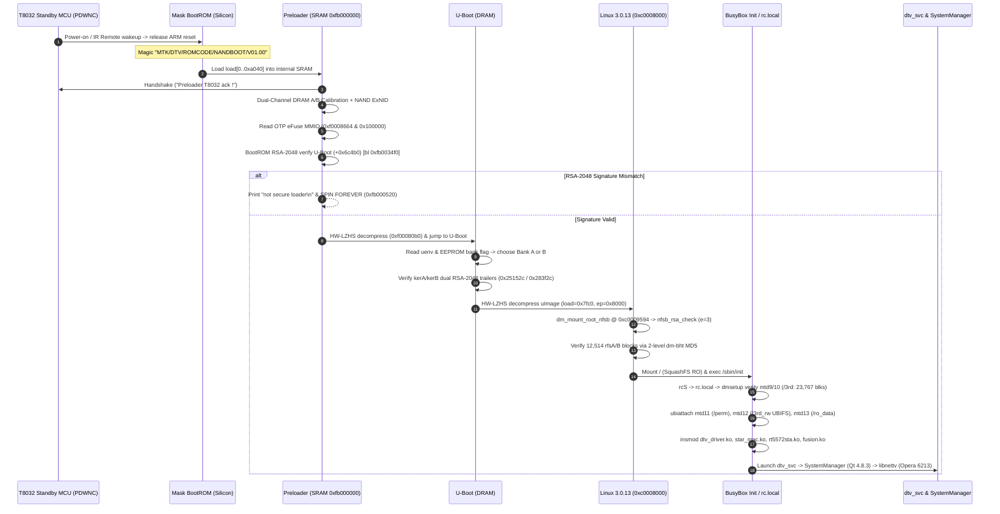

# Complete Boot Sequence Diagram (`Silicon` -> `Qt SystemManager`)

> **Vector Diagram:** [diagrams/BOOT_CHAIN.svg](../diagrams/BOOT_CHAIN.svg)

## Key Dependency & Timing Constraints

- `/etc/inittab` disables `ttyMT0` getty (`#1:2345:respawn:...`) and continuously respawns `/sbin/mnet_down.script` (`eth0`/`ra0` interface monitor).
- `appfs1/etc/init.d/rcS` starts optional `busybox readahead` from `/etc/readahead_early` (if present) before synchronously handing over to `/etc/rc.d/rc.local`.
- User-customizable writable persistence begins only **after** `ubi_mount_3rd_rw.sh` attaches `mtd12` (`ubi4:3rd_rw`) and `dtv_svc` inspects `/3rd_rw/upgrade/customer_version` (`0x036190`).
