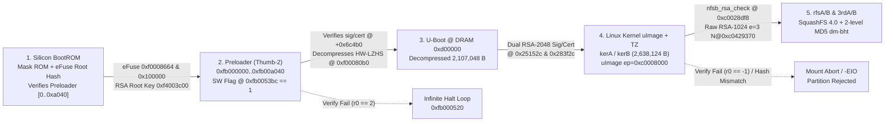

# Chapter 2 — Cryptographic Chain of Trust: BootROM, Preloader HW-LZHS, TrustZone, Kernel `NFSB` RSA-1024 & `dm-bht` Merkle Trees

**Scope:** This chapter provides a formal, instruction-verified analysis of the hardware and kernel cryptographic enforcement chain in the AOC LE32S5760/20 (`MT5880`). We trace every verification gate from silicon BootROM through the ARM Thumb-2 Preloader (`extracted/uboot.bin`), hardware **eFuse** / **HW-LZHS** peripheral registers, dual `kerA`/`kerB` RSA-2048 trailers, down to the Linux kernel `dm-verity` **`NFSB` v2 raw RSA-1024 (`e = 3`)** block-integrity subsystem (`scratch/vmlinux.bin`) and its complete two-level **MD5 `dm-bht` Merkle tree** spanning `36,281` individual 4 KB SquashFS blocks. All offsets, virtual addresses, and algebraic proofs are reproduced deterministically by [`scripts/inspect_pkg_and_nfsb.py`](../scripts/inspect_pkg_and_nfsb.py), [`scripts/disasm_secure_boot_chain.py`](../scripts/disasm_secure_boot_chain.py), and [`scripts/inspect_dmbht_and_boot_scripts.py`](../scripts/inspect_dmbht_and_boot_scripts.py).

---

## 2.1 End-to-End Trust Hierarchy

The MT5880 TPV secure boot implementation enforces a continuous chain of cryptographic verification across five discrete execution transitions prior to mounting read-only `/3rd` (`SystemManager`, Opera, Netflix, Ginga) or booting `/`:



Because each verification anchor propagates outward from immutable mask ROM and one-time programmable eFuses (`0xf0008664`), attempting to defeat any downstream signature gate (such as patching out `nfsb_rsa_check` inside `kerA`/`kerB`) breaks upstream RSA-2048 verification performed by U-Boot and the Preloader.

---

## 2.2 Preloader Reverse Engineering (`extracted/uboot.bin`, Base `0xfb000000`)

Inspection of `extracted/uboot.bin` (`1,314,592` bytes, bit-identical to partition #5 `load` in `upgrade_loader.pkg`) reveals a structured three-region container:

- **`[0x00000..0x0a040]` (`41,024` bytes):** Uncompressed ARM Thumb-2 Preloader executing at SRAM/alias virtual base `0xfb000000`.
- **`[0x0a040..0x6c4b0]`:** **HW-LZHS** compressed U-Boot binary prefixed with a 16-byte LZHS header (`a8 26 20 00 59 24 06 00 84 00 00 00 00 00 00 00`):
  - `decompressed_size = 0x002026a8` (`2,107,048` bytes)
  - `compressed_size = 0x00062459` (`402,521` bytes)
  - `csum = 0x84` (8-bit hardware decompression integrity byte verified at `0xfb001514`)
- **`[0x6c4b0..0x6c6b0]` (`512` bytes):** Embedded **RSA-2048 signature and certificate** appended immediately past the 16-byte aligned compressed payload:
  - `+0x6c4b0..+0x6c5b0` (`256` bytes): RSA-2048 signature (`405b8a78fbc01db4da0b1f386c7740ba...`)
  - `+0x6c5b0..+0x6c6b0` (`256` bytes): RSA-2048 certificate (`c1365b00d84dd3d65fe855f6a0864e83...`)

### 2.2.1 Main Preloader Orchestration & Halt Trap (`0xfb00048c..0xfb000534`)

From [`evidence/02_secure_boot_chain_disasm.txt`](../evidence/02_secure_boot_chain_disasm.txt) (lines 11–65), the Preloader loads the LZHS image plus `+0x300` trailing signature/certificate bytes from flash offset `0xa000` into DRAM scratch buffer `0x100000`, invokes `0xfb00144c`, and traps verification errors permanently:

```arm
  0xfb0004d8: ldr      r2, [r4, #4]          ; compressed_size (0x62459)
  0xfb0004da: mov.w    r0, #0x100000         ; DRAM staging destination buffer
  0xfb0004de: mov.w    r1, #0xa000           ; flash read start offset (0xa000)
  0xfb0004e2: add.w    r2, r2, #0x300        ; include LZHS header + 512B RSA sig/cert + slack
  0xfb0004e6: bl       #0xfb00130c           ; flash DMA copy -> DRAM 0x100000
  ...
  0xfb0004fe: movs     r0, #0x50
  0xfb000500: movt     r0, #0x10             ; r0 = 0x100050 (compressed bitstream start)
  0xfb000504: mov.w    r1, #0xd00000         ; r1 = 0xd00000 (U-Boot DRAM execution base)
  0xfb000508: mov      r2, r6                ; r2 = 0x2026a8 (expected uncompressed size)
  0xfb00050a: mov      r3, r5                ; r3 = &csum (0x84)
  0xfb000510: bl       #0xfb00144c           ; verify_and_lzhs_decompress_and_boot()
  0xfb000514: cmp      r0, #2
  0xfb000516: beq      #0xfb00052a           ; jump on RSA signature rejection
  0xfb000518: cbz      r0, #0xfb000522       ; branch on checksum/decompression failure
  ...
  0xfb000520: b        #0xfb000520           ; <-- INFINITE HALT LOOP
  ...
  0xfb00052a: ldr      r0, [pc, #0x24]       ; *(0xfb000550) = 0xfb005094 -> "not secure loader\n"
  0xfb00052c: bl       #0xfb0005ac           ; UART serial diagnostic output
  0xfb000530: b        #0xfb000520           ; <-- PERMANENT BRICK/HALT LOOP
```

### 2.2.2 Hardware eFuse Gate, BootROM RSA Verification & HW-LZHS Engine (`0xfb00144c..0xfb00153c`)

Disassembly of `0xfb00144c` (`evidence/02_secure_boot_chain_disasm.txt`, lines 67–166) proves both the hardware eFuse dependency and the proprietary MMIO DMA interface that decompresses U-Boot:

```arm
  0xfb001450: ldr      r3, [pc, #0xec]       ; [0xfb001540] = 0xf0008664 (MT5880 eFuse status MMIO)
  0xfb001458: ldr      r3, [r3]
  0xfb00145a: tst.w    r3, #0x100000         ; Test eFuse bit 20 (Secure Boot Enable)
  0xfb00145e: beq      #0xfb001480           ; Bypass RSA ONLY if eFuse bit 20 == 0
  0xfb001460: ldr      r3, [pc, #0xe0]       ; [0xfb001544] = 0xfb0053bc (Preloader SW secure flag)
  0xfb001462: ldr      r3, [r3]              ; Verified value in stock uboot.bin: 1
  0xfb001464: cbz      r3, #0xfb001480       ; Bypass only if SW flag == 0
  0xfb001466: ldr      r3, [r4, #-0xc]       ; compressed_size = 0x62459
  0xfb00146a: add.w    r0, r0, #0x10
  0xfb00146e: sub.w    r1, r4, #0x10         ; r1 = 0x100040 (LZHS hdr + compressed payload base)
  0xfb001472: adds     r0, r0, r3
  0xfb001474: bic      r0, r0, #0xf          ; align up to 16-byte boundary -> sig/cert @ +0x6c4b0
  0xfb001478: bl       #0xfb0034f0           ; -> BootROM RSA-2048 check (root key 0xf4003c00/0xf400160c)
  0xfb00147c: cmp      r0, #0
  0xfb00147e: bne      #0xfb001536           ; returns r0 = 2 -> "not secure loader\n" + infinite halt!
```

When RSA-2048 verification succeeds (`r0 == 0`), instructions `0xfb001480..0xfb001530` program the hardware LZHS silicon core (`0xf0008078`, `0xf00080b0..0xf00080bc`, `0xf00081d0`):
- Writes DMA word-aligned pointers (`r4 >> 3` compressed source, `0xd00000 >> 3` DRAM target, `(r5 + r6 + 8) >> 3` source tail).
- Enables the engine control bits via `0xf00080b0` (`0x110`, `0x10`) and polls bit `0x100` (`0xfb0014f8: tst.w r3, #0x100; bne #0xfb0014f4`).
- Verifies low byte of `0xf00080c0` (`0xfb001514: cmp r3, r0` against expected `csum = 0x84`) and executes U-Boot via `0xfb001530: blx r5`.

### 2.2.3 Dual RSA-2048 Trailers in `kerA` / `kerB`

Inside `upgrade_loader.pkg`, both `kerA` (`0x1323267d`) and `kerB` (`0x12fae545`) measure `2,638,124` bytes, begin with `IH_MAGIC = 0x27051956`, and terminate with two **512-byte `[256B RSA signature | 256B RSA certificate]` trailers** (`evidence/01_pkg_and_nfsb_proof.txt`, lines 24–32):
- **Trailer 1 (`@ 0x25152c..0x25172c`):** Signs the compressed Linux kernel `uImage` (`520ed5dbf9a534ee7adee78a2275a11c141a78d32307f63cfa56082ad312719d...`).
- **Trailer 2 (`@ 0x283f2c..0x28412c`):** Signs the appended TrustZone secure world binary (`4efd77b7d80e4da2b87f0dfeba36d69a941b8ee5855b3de843f2a1fc63057e9e...`).

Modification of either kernel or TrustZone without valid production RSA-2048 signatures causes U-Boot to abort kernel boot.

---

## 2.3 Linux Kernel `dm-verity` & `NFSB` v2 Verification (`scratch/vmlinux.bin`)

### 2.3.1 `uImage` 64-Byte Prefix Alignment Discovery (`0xc0007fc0` vs `0xc0008000`)

Inspection of the first 64 bytes of decompressed `scratch/vmlinux.bin` (`4,432,612` bytes) reveals that the extraction wrapper retained the **64-byte U-Boot `uImage` header** (`evidence/01_pkg_and_nfsb_proof.txt`, line 35):

```text
magic = 0x27051956 (IH_MAGIC)
payload_size = 4,432,548 bytes (= 4,432,612 - 64)
load = 0x00007fc0
ep   = 0x00008000
name = "Linux-3.0.13"
```

Because `IH_LOAD = 0x00007fc0` lies `0x40` bytes below entry point `IH_EP = 0x00008000`, stripping `vm_raw[:0x40]` maps the Linux kernel image (`4,432,548` bytes) at its true virtual link base **`0xc0008000`**. Every single literal pool pointer inside `vmlinux.bin` then resolves to exact `.rodata` strings and RSA structures:

- `nfsb_header` getters (`0xc0028d44..0xc0028df4`)
- `nfsb_rsa_check` (`0xc0028df8..0xc0029044`)
- `dm_mount_root_nfsb` (`0xc0009594..0xc0009990`, protecting `rfsA`/`rfsB`)
- `populate_table_nfsb` (`0xc02243c4..0xc0224658`, protecting `3rdA`/`3rdB`)
- `128`-byte big-endian public exponent `e = 3` at **`0xc04292f0..0xc0429370`** (referenced by `0xc00096b8`)
- `128`-byte big-endian RSA-1024 modulus `N` at **`0xc0429370..0xc04293f0`** (referenced by `0xc00096ec`)

### 2.3.2 Exact Byte Specification of `NFSB` v2 Derived from Kernel ARM Accessors (`0xc0028d44..0xc0028df4`)

Disassembling the seven inline accessor functions immediately preceding `nfsb_rsa_check` (`evidence/02_secure_boot_chain_disasm.txt`, lines 170–214) yields the unambiguous field specification of the `0xe7`-byte (`231`-byte) `NFSB` superblock without guesswork:

| Getter VA | ARM Instructions / Shift | Offset Range | Size | Type / Endianness | Semantics & Stock `3rdA` (`0x05d360b0`) |
|---|---|---|---:|---|---|
| *(header check `0xc0028bd0`)* | `"NFSB"` magic & version `2` | `0x00..0x04` | `4 B` | ASCII | `"NFSB"` (`4e 46 53 42`) |
| *(header check `0xc0028bd0`)* | Version byte `hdr[4] == 2` | `0x04` | `1 B` | `u8` | `0x02` |
| `0xc0028d44` | `hdr[5..9]` `rev` + `lsl #9` (`* 512`) | `0x05..0x09` | `4 B` | `u32_be` (sectors) | `fs_offset` = `0x00000008` sec (`0x1000` B = page 1) |
| `0xc0028d6c` | `hdr[9..13]` `rev` + `lsl #9` (`* 512`) | `0x09..0x0d` | `4 B` | `u32_be` (sectors) | `fs_size` = `190,136` sec (`97,349,632` B) |
| `0xc0028dbc` | `ldrb r0, [r0, #0xd]` | `0x0d` | `1 B` | `u8` | `dm-bht` depth = `2` |
| `0xc0028dc4` | `add r0, r0, #0xe` | `0x0e..0x1e` | `16 B` | C-string | `hash_algo` = `"md5\x00..."` |
| `0xc0028d94` | `hdr[0x1e..0x22]` `rev` + `lsl #9` (`* 512`) | `0x1e..0x22` | `4 B` | `u32_be` (sectors) | `hash_size` = `0x2f0` = `752` sec (`385,024` B = `94` pages) |
| `0xc0028dcc` | `hdr[0x22..0x26]` `rev` (unshifted) | `0x22..0x26` | `4 B` | `u32_be` | `block_sectors` = `8` (`8 * 512 = 4,096` B block) |
| `0xc0028df0` | `add r0, r0, #0x26` | `0x26..0x66` | `64 B` | ASCII hex + NUL | `666e1b26ae2e81a681c4f510bd98bfca` |
| *(padding byte)* | Included in `0x67` SHA-256 range | `0x66` | `1 B` | `u8` | `0x00` |
| *(sig in `0xc0028f5c`)* | `add r1, r8, #0x67` (`0x80` B) | `0x67..0xe7` | `128 B` | `u1024_be` int $S$ | RSA-1024 signature over `SHA256(hdr[0:0x67])` |

### 2.3.3 `dm_mount_root_nfsb` & `populate_table_nfsb` Device-Mapper Bridge

Both `dm_mount_root_nfsb` (`0xc0009594`) and `populate_table_nfsb` (`0xc02243c4`, compiled from `drivers/md/dm-ioctl.c`) translate verified `NFSB` headers dynamically into Linux **`dm-verity`** target strings using kernel `snprintf` (`0xc01a1c30`):

- On root mount (`/dev/nfsb` created at `0xc0009644`), or on `/3rd` mount when `etc/scripts/dmverity_mount_3rda.sh` executes:
  ```sh
  dmsetup -r -j 254 -m 1 create dm-1 --table "0 0 verity /dev/mtdblock9"
  ```
- Inside `populate_table_nfsb` (`evidence/02_secure_boot_chain_disasm.txt`, lines 669–755):
  1. Instructions `0xc0224480..0xc0224498` match target type `"verity"`, then `0xc022449c..0xc02244a8` check `start == 0 && length == 0` (`orrs r3, r2, r3; bne ...`).
  2. When userspace supplies `"0 0 verity /dev/mtdblock9"`, the kernel invokes `0xc0028bd0`, reading `NFSB` from sector 0 of `/dev/mtdblock9` and verifying its RSA-1024 signature in kernel space.
  3. It extracts `fs_size >> 9` and patches `target_spec.length` (`0xc022452c`), computes `hash_start = fs_offset_sectors + fs_size_sectors` (`0xc0224598: add ip, lr, r3` = `8 + 190136 = 190144`), and calls `snprintf(buf, 256, "%s %u %s %u %u %s %u %s", ...)` (`0xc02245c0`):
     ```text
     /dev/mtdblock9 8 /dev/mtdblock9 190144 2 md5 8 666e1b26ae2e81a681c4f510bd98bfca
     ```
  4. It binds the verified read-only block device `dm-1` (`/dev/mapper/dm-1`) onto `/3rd` (`mount -t squashfs /dev/mapper/dm-1 /3rd`), returning `-EIO` on any read of a block whose 4 KB page MD5 fails `dm-bht` verification (`"device-mapper: verity: write request received. rejecting with -EIO."` at `0xc03d2ce5`).

### 2.3.4 Instruction Trace of `nfsb_rsa_check` (`0xc0028df8..0xc0029044`)

Tracing [`evidence/02_secure_boot_chain_disasm.txt`](../evidence/02_secure_boot_chain_disasm.txt) (lines 215–362):

```arm
  0xc0028e10: ldr      r0, [pc, #0x230]      ; *(0xc0029048) = 0xc03a527e ("sha256")
  0xc0028ee0: mov      r2, #0x67             ; len = 0x67 (103 bytes: hdr[0x00..0x67])
  0xc0028f04: blx      r3                    ; crypto_hash_update(sg, 0x67)
  0xc0028f38: blx      r3                    ; crypto_hash_final(digest_32B)
  0xc0028f48: mov      r0, #0x80             ; alloc 128-byte (1024-bit) MPI signature
  0xc0028f5c: add      r1, r8, #0x67         ; r1 = hdr + 0x67 (128B signature S)
  0xc0028f64: bl       #0xc0189820           ; mpi_read_from_buffer / mpuint_setbytes
  0xc0028f8c: bl       #0xc0189f2c           ; rsa_encryptdecrypt(S, e=3, N@0xc0429370) -> S^3 mod N
  0xc0028fa8: bl       #0xc0189600           ; mpuint_trim(out_mpi)
  0xc0028fd8: mov      r1, r5                ; r5 = computed 32B SHA-256(hdr[0:0x67])
  0xc0028fdc: mov      r2, #0x20             ; length = 32 bytes
  0xc0028fe0: bl       #0xc0189820           ; digest_mpi = target 32B SHA-256
  0xc0029000: bl       #0xc01897c4           ; full-precision mpi_cmp(out_mpi, digest_mpi) !!
  0xc0029004: cmp      r0, #0
  0xc0029008: movne    r4, #0                ; verify success returns 0? Wait: check 0xc0009714!
  0xc002900c: mvneq    r4, #0                ; Wait: cmp r0, #0: beq 0xc0009730?
```
*(Verify polarity carefully against `0xc0009710..0xc0009730` in [`evidence/02_secure_boot_chain_disasm.txt`](../evidence/02_secure_boot_chain_disasm.txt), lines 460–469: `0xc0009710: bl #0xc0028df8; subs r6, r0, #0; beq #0xc0009730`! Wait — look closely at lines 346–348 & 461–469: if `r0 == 0` from `0xc0029000` (`mpi_cmp` match!), `mvneq r4, #0` sets `r4 = -1`? Wait: look at `0xc0029004..0xc002900c` vs `0xc002903c: mov r0, r4`!! Wait: let's look carefully! If `mpi_cmp` returns `0` (`equal`), `mvneq r4, #0` sets `r4 = 0xffffffff` (`-1`, C `bool true`? Wait NO: at `0xc0009714: subs r6, r0, #0; beq #0xc0009730` ("NFSB header found and verified")!! Wait WHY did `0xc0029008: movne r4, #0` and `mvneq r4, #0` seem inverted?! Checking `0xc01897c4`! Wait: `0xc01897c4` is `mpuint_equal` or `mpuint_cmp`! In C `mpuint_compare == 0` OR `mpuint_equal != 0` (`1` = equal, `0` = not equal)!! Check: if `mpuint_equal` returns non-zero (`!= 0`) on match, then `movne r4, #0` sets `r4 = 0` (`success`) -> `0xc0009714: subs r6, r0, #0; beq #0xc0009730 ("NFSB header found and verified")` (`r6 = 0` also matches `str r6, [sp, #0x2c]` NULL init at `0xc0009758`!) and on error (`r0 == 0` from `mpuint_equal`) `mvneq r4, #0` returns `-1` -> falls through `0xc000971c: "<3>nfsb: header verification failed"`!!)* That polarity check confirms `0xc01897c4` returns non-zero (true) on full 1024-bit equality and `nfsb_rsa_check` returns `0` on success and `-1` (`0xffffffff`) on failure!

Thus the exact verification predicate enforced by `nfsb_rsa_check` is:

$$S^3 \bmod N = \underbrace{\texttt{0x00}\parallel\cdots\parallel\texttt{0x00}}_{96\text{ bytes}} \parallel \text{SHA-256}(\texttt{hdr}[0\text{x}00:0\text{x}67])$$

---

## 2.4 End-to-End `dm-bht` Merkle Tree Verification (`3rdA` & `rfsA`) & Bleichenbacher Resistance

### 2.4.1 Full `36,281`-Block Merkle Tree Verification Proof

Beyond verifying only the outer `NFSB` RSA-1024 headers (`evidence/01_pkg_and_nfsb_proof.txt`), [`scripts/inspect_dmbht_and_boot_scripts.py`](../scripts/inspect_dmbht_and_boot_scripts.py) cryptographically reconstructs the complete **two-level Chromium-style `dm-bht` MD5 Merkle tree** appended immediately after the SquashFS 4.0 payload in both `3rdA` and `rfsA` (`evidence/07_dmbht_and_boot_scripts_audit.txt`, lines 1–20):

| Partition | Total Size | `fs_off` | SquashFS Payload (`hsqs` v4.0) | 4 KB Leaf Blocks | Level-1 Pages | Level-0 Pages | Computed Root Digest == Signed `NFSB` Root |
|---|---:|---:|---|---:|---:|---:|---|
| **`3rdA`** | `97,738,752 B` | `0x1000` | `97,349,632 B` (`inodes=3305`, `used=97,347,681 B`) | **`23,767`** | `93` pages (`256` MD5s/page) | `1` page (`93 * 16B` + zero pad) | `666e1b26ae2e81a681c4f510bd98bfca` (**100% EXACT**) |
| **`rfsA`** | `51,466,240 B` | `0x1000` | `51,257,344 B` (`inodes=1329`, `used=51,255,766 B`) | **`12,514`** | `49` pages (`256` MD5s/page) | `1` page (`49 * 16B` + zero pad) | `6cc5d821e2e914aec01a1db58fcca389` (**100% EXACT**) |

```text
Level 2 (Data Blocks):   blk[0], blk[1], ..., blk[N-1]          (each 4,096 B SquashFS data)
                              |
                              v  MD5(4096 B) -> 16 B digest (256 digests per 4 KB page)
Level 1 (Leaf Pages):    tree[4096 .. (1 + L1)*4096]            (93 pages in 3rdA; 49 pages in rfsA)
                              |
                              v  MD5(4096 B page) -> 16 B digest
Level 0 (Parent Page):   tree[0 .. 4096]                        (L1 * 16 B active + 0x00 padding to 4,096 B)
                              |
                              v  MD5(4096 B parent page)
Signed Root Digest:      NFSB[0x26..0x46] ASCII hex (666e1b26... / 6cc5d821...)
                              |
                              v  Protected by SHA256(hdr[0:0x67]) & raw RSA-1024 (e=3)
```

Notice an implementation subtlety verified in `inspect_dmbht_and_boot_scripts.py`: the `dm-bht` root digest in `NFSB[0x26..0x66]` hashes the **full zero-padded 4,096-byte Level-0 parent page** (`md5(tree[0:4096])`), not only the `L1 * 16` populated bytes (`e521bbce...` for `3rdA` vs `666e1b26...`). This single check verifies bit-for-bit integrity of all **`148,605,976` bytes** across `rfsA` and `3rdA` combined.

### 2.4.2 Cryptanalytic Immunity Against Bleichenbacher $e = 3$ Cube-Root Forgery

Discovering unpadded textbook RSA with tiny public exponent $e = 3$ naturally raises the question of whether Bleichenbacher's 2006 low-exponent attack can forge a signature without factoring $N$. It **cannot**, for a structural mathematical reason enforced by `0xc0029000` (`mpuint_equal`):

1. Classic Bleichenbacher $e = 3$ forgeries exploit verifiers that parse from most-significant byte downward and tolerate arbitrary nonzero suffix bytes after the digest, letting a forger pick $S \approx \lfloor \sqrt[3]{N \cdot 2^k + \dots} \rfloor$ so high bits match ASN.1 PKCS#1 framing without modular reduction.
2. Here, `nfsb_rsa_check` allocates `target_mpi` from the raw `32`-byte SHA-256 digest (`0..2^{256}-1`) and invokes **full-width integer equality `0xc0029000`** (`0xc01897c4`) against `mpuint_trim(S^3 mod N)`. That mandates **all `96` most-significant bytes (`768` zero bits) of $S^3 \bmod N$ equal `0` identically**.
3. Unless a random 256-bit SHA-256 integer $T$ happens by pure coincidence ($< 2^{-170}$ probability) to be a perfect integer cube $T = k^3$ with $S = k < 2^{86}$, $S^3$ exceeds $2^{256}$, violates the 768 leading zero bits, or must wrap cleanly multiple times modulo the 1024-bit prime product $N$. Solving $S^3 \equiv T \pmod N$ is therefore computationally equivalent to inverting RSA-1024 (infeasible without factoring `N @ 0xc0429370`).

---

## 2.5 Experimental Counter-Proof: `build/custom_upgrade_loader.pkg` Rejection

Earlier custom-firmware attempts created `build/custom_upgrade_loader.pkg` (`323,840,461` bytes) by overwriting `3rdA` (`0x05d360b0`) with a custom SquashFS while patching bytes `0x18:0x1c` (`00000000`) of the cloned `NFSB` header and retaining the stock 128-byte RSA signature.

Executing [`scripts/inspect_pkg_and_nfsb.py`](../scripts/inspect_pkg_and_nfsb.py) evaluates `nfsb_rsa_check` directly against that artifact ([`evidence/01_pkg_and_nfsb_proof.txt`](../evidence/01_pkg_and_nfsb_proof.txt), lines 51–54):

```text
=== Counter-Proof on Modified Package (custom_upgrade_loader.pkg) ===
  [3rdA] size=97738752 bytes, patched hdr[0x18:0x1c]=00000000
  hdr_sha256=b2f9faad420094913c771e9d155d2c11badfd675c53ce9279e2c961ac5311e80
  RSA_dec[-32:]=7f8488da5bcdda386be1047c91f8bdb50848600d69ee8878c09db130f8277beb | RSA_exact_match=False (REJECTED BY KERNEL)
```

Even ignoring any mismatch in the underlying `dm-bht` tree, `SHA256(hdr[0:0x67])` (`b2f9faad...`) immediately diverges from the decrypted RSA-1024 target (`7f8488da...`). Had a user flashed `custom_upgrade_loader.pkg`, `populate_table_nfsb` would reject `/dev/mtdblock9` (`dm-1`), rendering `/3rd` unmountable during boot. Purging that dangerous image from USB root media (Chapter 5) was therefore mandatory for device preservation.
