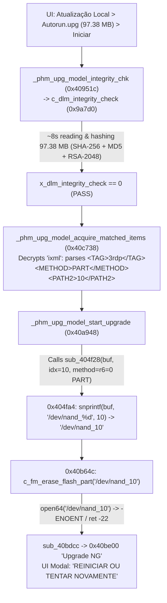

# Chapter 3 — Philips/TPV DLM `.upg` Cryptographic Format & `libmtkapp.so` State Machine Internals

**Scope:** This chapter documents the complete reverse engineering of MediaTek/TPV's Download Manager (`libdtv_common.so`) and TV upgrade application engine (`libmtkapp.so`). We establish the complete algebraic specification of `Autorun.upg` across all five cryptographic layers, analyze the empirical 8-second UI upgrade failure (`REINICIAR OU TENTAR NOVAMENTE`), expose the latent `3rdp` dual-bank EEPROM skip defect, and reference the complete instruction traces in [`evidence/03_upg_installer_disasm.txt`](../evidence/03_upg_installer_disasm.txt) and [`evidence/04_upg_container_crypto_proof.txt`](../evidence/04_upg_container_crypto_proof.txt).

---

## 3.1 Five-Layer Architecture of the `.upg` (`Autorun.upg`) Container

Unlike cold-boot factory recovery packages (`upgrade_loader.pkg`), runtime local USB and network updates (`Casinha > Configurar > Configurar software > Atualização local`) process `.upg` containers jointly through `libdtv_common.so` (`x_dlm_*` / `dlm_*`) and `libmtkapp.so` (`_phm_upg_*`).

Disassembling `dlm_locate_codefile_hdr` (`0x98b60`), `x_dlm_download_by_tag` (`0x9924c` / `0x995b4`), `x_dlm_integrity_check` (`0x9a7d0`), `dlm_aes` (`0x97154`), and `x_dlm_set_aes_key_iv` (`0x9b7ec`) inside `extracted/appfs1/basic/libdtv_common.so`, combined with the `/ro_data/key` loader at `0x4060d0..0x4061b0` inside `extracted/appfs1/basic/libmtkapp.so`, exposes a five-layer container protocol:

```text
+-----------------------------------------------------------------------------------+
| [0x000 .. 0x080)  128 B : Outer filename prefix ("Autorun.upg\x00...")             |
+-----------------------------------------------------------------------------------+
| [0x080 .. 0x0F0)  112 B : EncHdr = AES-128-CBC(K_mtk, IV=0, PlainHdr_0x70)         |
|                           PlainHdr: "TPV\0" + "#DH@FiRm" + ID_str + body_len +    |
|                                     flags + "LE32S5760/20"                        |
+-----------------------------------------------------------------------------------+
| [0x0F0 .. 0x110)   32 B : EncMD5 = AES-128-CBC(K_mtk, IV=0,                       |
|                                                MD5(EncHdr || 0x00*32 || Chunks)   |
|                                                || 0x00*16)                        |
+-----------------------------------------------------------------------------------+
| [0x110 .. end-256) Var  : Sequential Tagged Chunks [Chunk_1, Chunk_2, ...]        |
|                           Each chunk = 60 B descriptor + sz B payload:            |
|                             [0x00..0x04) : 4 B ASCII Tag ("ixml", "smth", "3rdp")  |
|                             [0x04..0x08) : u32_le chunk_flags (0 = plaintext)     |
|                             [0x08..0x0C) : u32_le payload_size                    |
|                             [0x0C..0x1C) : AES-128-CBC(K_tv, IV_tv, "reserved mtk inc") |
|                             [0x1C..0x3C) : AES-128-CBC(K_tv, IV_tv, SHA256(payload))    |
|                             [0x3C..+sz ) : Raw payload bytes                      |
+-----------------------------------------------------------------------------------+
| [end-256 .. end)  256 B : Raw RSA-2048 PKCS#1 v1.5 Signature (no ASN.1 prefix)    |
|                           signed over SHA256(file[0x080 : end-256])               |
+-----------------------------------------------------------------------------------+
```

### 3.1.1 Hardcoded MTK Internal Key (`K_mtk`) & `#DH@FiRm` Envelope (`dlm_locate_codefile_hdr`)

In `libdtv_common.so`, `dlm_locate_codefile_hdr` (`0x98b60..0x98ce0`, [`evidence/03_upg_installer_disasm.txt`](../evidence/03_upg_installer_disasm.txt), lines 261–358) synthesizes the outer DLM cipher key directly from immediate instructions:

```arm
  0x098b64: movw     r3, #0x2909
  0x098b74: movt     r3, #0x9410             ; r3 = 0x94102909 (little-endian bytes: 09 29 10 94)
  0x098b9c: mov      r2, #0x10
  0x098ba0: str      r3, [sp, #0x44]
  0x098bbc: bl       #0x379d0                ; memset(iv_buf, 0, 16) -> IV_mtk = 0x00 * 16
  0x098bd4..0x098c04: bl #0x3845c (x4)       ; key_buf = [09 29 10 94] * 4 (16 bytes AES-128 key)
  0x098c10: mov      r2, #0x90               ; try offset 0x00 first (#0x90 = header 0x70 + MD5 0x20)
  0x098c14: bl       #0x97600
  ...
  0x098c6c: bl       #0x37370                ; decrypt 0x70 bytes with (K_mtk, IV_mtk)
  0x098ca0: bl       #0x3a8a4                ; memcmp(hdr + 4, "#DH@FiRm", 8)
  0x098ccc: mov      r2, #0x110              ; on mismatch at 0x00, retry skipping 128B prefix (0x80)!
```

Thus:

$$K_{\text{mtk}} = \texttt{09 29 10 94 09 29 10 94 09 29 10 94 09 29 10 94}_{16}, \quad \text{IV}_{\text{mtk}} = \texttt{00}^{16}$$

Decrypting `data[0x80:0xF0]` yields the exact `0x70`-byte (`112`-byte) DLM header verified on factory and research containers:

| Offset (Rel `0x80`) | Size | Field Semantics | Observed Value on `AOC LE32S5760/20` |
|---|---:|---|---|
| `0x00..0x04` | `4 B` | Vendor UID (`flags & 0x10` check @ `0x9b00c`) | `b"TPV\x00"` |
| `0x04..0x0C` | `8 B` | Container magic (`0x98c8c`) | `b"#DH@FiRm"` (`0x18e0b0`) |
| `0x0C..0x48` | `60 B` | Product / branch ID (`flags & 0x20`) | `b"IDTV0801_002224_9_001_23_001_225\x00..."` |
| `0x48..0x4C` | `4 B` | `u32_le signed_body_len` (`0x9ac24`) | `len(file) - 0x80 - 256` (`0x90 + sum(chunks)`) |
| `0x4C..0x50` | `4 B` | `u32_le hdr_check_flags` (`0x9a98c`) | `0x00000000` (vendor/version bitmask flags) |
| `0x50..0x70` | `32 B` | Target model string (`flags & 0x40` @ `0x9b06c`) | `b"LE32S5760/20\x00..."` |

### 3.1.2 Zeroed-Slot Body MD5 and Non-Standard 33-Byte Key Derivation (`AES_Prod`)

Three subtle implementation behaviors verified across `libmtkapp.so` and `libdtv_common.so` explain why naive UPG packagers fail verification unless they mirror exact binary semantics:

1. **Zeroed-Slot Body MD5 (`x_dlm_integrity_check` @ `0x9ab44..0x9acc0`):**
   - `x_dlm_integrity_check` decrypts `[0xF0..0x110]` (`32` bytes) under $(K_{\text{mtk}}, \text{IV}=0)$ and extracts the 16-byte expected MD5 digest in `dec_md5[:16]` (remaining 16 bytes zero-padded).
   - Crucially, `0x9ab68` zeros the 32-byte digest slot in memory (`memset(buf + 0x70, 0, 0x20)`) **while leaving the already-encrypted header bytes `[0x80..0xF0]` encrypted**, and then feeds `[EncHdr || 0x00*32 || Chunks]` to MD5:

   $$\text{BodyMD5} = \text{MD5}(\text{EncHdr}_{[0\text{x}80:0\text{x}F0]} \parallel \texttt{0x00}^{32} \parallel \text{Chunks}_{[0\text{x}110:\text{end}-256]})$$

   - When tested on the user's original failed `97.38 MB` `Autorun.upg`, `BodyMD5` (`78a65e09a0bedb58392d5f33da6fb8a7`) matched cleanly, explaining why the TV spent ~8 seconds verifying SHA-256 + MD5 + RSA-2048 before even examining any flash tag!

2. **33-Byte Trailing-Newline-Inclusive Key/IV Hashing (`0x4060d0..0x4061b0` & `0x995b4..0x99698`):**
   - Look closely at [`evidence/03_upg_installer_disasm.txt`](../evidence/03_upg_installer_disasm.txt) (lines 142–199) in `libmtkapp.so`:
     ```arm
     0x4060d0: bl #0xfca38        ; c_dlm_set_rsa_public_key("/ro_data/key/...PubKey_Prod.pem")
     0x4060e4: bl #0x405eb0       ; get_file_size("...AES_Prod.key") -> returns 33 bytes (32 hex + '\n')!
     0x406108: bl #0x107e50       ; malloc(33)
     0x406120: bl #0x108180       ; fread(buf, 1, 33, fp_key)  (NO ASCII hex parse, NO trim!)
     0x40613c: bl #0x405eb0       ; get_file_size("...AES_Prod.iv")  -> returns 33 bytes (32 hex + '\n')!
     0x406174: bl #0x108180       ; fread(buf, 1, 33, fp_iv)
     0x40619c: bl #0x10d118       ; c_dlm_set_aes_key_iv(key_buf, 33, iv_buf, 33)
     ```
   - Next, `x_dlm_download_by_tag` (`0x995b4..0x99698`, lines 359–416 of [`evidence/03_upg_installer_disasm.txt`](../evidence/03_upg_installer_disasm.txt)) runs **two independent `MD5` passes** (`0x38390` `MD5_Init`, `0x39efc` `MD5_Update(..., len=33)`, `0x37214` `MD5_Final`):

   $$K_{\text{tv}} = \text{MD5}(\text{raw\_bytes}_{33\text{B}}(\texttt{AES\_Prod.key})), \qquad \text{IV}_{\text{tv}} = \text{MD5}(\text{raw\_bytes}_{33\text{B}}(\texttt{AES\_Prod.iv}))$$

   - Because `/ro_data/key/TPV_MTK2K14PLF_LT0_UPG_AES_Prod.key` and `.iv` each store 32 lowercase ASCII hex characters followed by LF (`0x0a`, total `33` bytes), hex-decoding them to 16 bytes directly **never matches** the TV's runtime keys — hashing all 33 raw bytes with MD5 is mandatory.
   - Inside every 60-byte chunk descriptor:
     - `0x99644..0x99670`: Decrypts bytes `[0x0C..0x1C]` (`16` B) using $(K_{\text{tv}}, \text{IV}_{\text{tv}})$ and compares (`0x3a8a4` `memcmp`) to the literal constant **`"reserved mtk inc"`** (`0x18e250`).
     - `0x9967c..0x99694`: Re-initializes AES-128-CBC with fresh $(K_{\text{tv}}, \text{IV}_{\text{tv}})$ (`stm sp, {r8, r7}`), decrypting `[0x1C..0x3C]` (`32` B) to obtain the expected `SHA-256(payload)`.

3. **Raw PKCS#1 v1.5 RSA-2048 Trailer (`data[-256:]`):**
   - `x_dlm_integrity_check` (`0x9acc0..0x9af30`, `"New Philips Signature"` @ `0x18e818`) computes `SHA-256(data[0x80:-256])` (`32` bytes), calls `RSA_public_decrypt` with `TPV_MTK2K14PLF_LT0_UPG_PubKey_Prod.pem`, and asserts **`cmp r8, #0x20` (`0x9af1c`)**: exact `32`-byte decrypted digest with **no ASN.1 DER `DigestInfo` prefix**. Signers therefore invoke raw PKCS#1 v1.5 padding over the 32-byte digest directly (`openssl pkeyutl -sign`), never standard `-dgst` wrapping.

---

## 3.2 Forensic Proof: The 8-Second `"REINICIAR OU TENTAR NOVAMENTE"` UI Failure

Correlating user-observed timing (`Casinha > Configurar > Configurar software > Atualização local > Autorun.upg > Iniciar` -> `...` for ~8 seconds -> `"REINICIAR OU TENTAR NOVAMENTE"`) with `libmtkapp.so` disassembly pinpoints the exact instruction sequence responsible for the failure:



### 3.2.1 Disassembly Proof of Device Path Formatting (`sub_404f28`, `0x404f28..0x405040`)

From [`evidence/03_upg_installer_disasm.txt`](../evidence/03_upg_installer_disasm.txt) (lines 34–105), `sub_404f28` switches on XML `<METHOD>` integer enum `r6` with partition index `r7` (`<PATH2>`):

```arm
  0x404f54: cmp      r6, #0
  0x404f5c: beq      #0x404fa4               ; r6 == 0 (METHOD=PART) -> format "nand_%d" (0x5ae80c) -> /dev/nand_10!
  0x404f60: cmp      r6, #1
  0x404f64: beq      #0x404fd4               ; r6 == 1 (METHOD=PMTD) -> lookup PMTD[r7] table!
  0x404f68: cmp      r6, #2
  0x404f6c: beq      #0x404fbc               ; r6 == 2 (METHOD=PSDM) -> format "sdm%d"
  0x404f70: cmp      r6, #4
  0x404f74: bne      #0x405008               ; r6 == 4 (METHOD=EEP)  -> format "eeprom_%d" (else log line 0xaf3 & err -1)
```

For `r6 == 1` (`<METHOD>PMTD</METHOD>`), instruction `0x404fe8` enforces bounds `r7 <= 0x16` (`22`) and indexes `.rodata` pointers stored at `0x5b0b54..0x5b0c0c` (`evidence/03_upg_installer_disasm.txt`, lines 11–32):

| `r7` Index | `.rodata` Offset | Device Token (`PMTD`) | Target Flash Node | `cfig` Partition Mapping |
|---:|---|---|---|---|
| `0..5` | `0x5b0b54..0x5b0b7c` | `mtd0`..`mtd5` | `/dev/mtd0`..`/dev/mtd5` | `uenv`(`1`), `kerA`(`4`), `kerB`(`5`) |
| `6..7` | `0x5b0b84..0x5b0b8c` | `mtd6`, `mtd7` | `/dev/mtd6`, `/dev/mtd7` | `rfsA`(`6`), `rfsB`(`7`) |
| `8` | `0x5b0b94` | `mtd8` | `/dev/mtd8` | System / recovery reserved |
| `9` | `0x5b0b9c` | `mtd9` | `/dev/mtd9` | `3rdA` (`NFSB` SquashFS primary) |
| **`10`** | `0x5b0ba4` | **`mtd10`** | **`/dev/mtd10`** | **`3rdB` (`NFSB` SquashFS secondary)** |
| `11` | `0x5b0bac` | `mtd11` | `/dev/mtd11` | `perm` (`/perm` calibration/keys) |
| **`12`** | `0x5b0bb4` | **`mtd12`** | **`/dev/mtd12`** | **`3rdw` (`/3rd_rw` UBIFS read-write)** |
| `13` | `0x5b0bbc` | `mtd13` | `/dev/mtd13` | `roda` (`/ro_data` keys) |
| `14..20` | `0x5b0bc4..0x5b0c0c` | `mtdsdm14`..`mtdsdm20` | `/dev/mtdsdm14`..`20` | `game`(`14`), `pqda`(`17`), `aqda`(`18`) |

Because legacy `tools/build_autorun_upg.py` originally emitted `<METHOD>PART</METHOD><PATH2>10</PATH2>`, `sub_404f28` formatted `"/dev/nand_10"`. On the MT5880 Linux kernel, NAND devices expose `/dev/mtd*` rather than `/dev/nand_*`, guaranteeing `open64("/dev/nand_10") -> -22 ENOENT` right after the 8-second RSA pass completes.

---

## 3.3 The Hidden `3rdp` Dual-Bank EEPROM Skip Anomaly (`0x40ae50..0x40af20`)

Even had `<METHOD>PMTD</METHOD>` been selected (and setting aside Chapter 2's proof that kernel `NFSB` rejects unsigned/modified SquashFS partitions), disassembly of `_phm_upg_model_start_upgrade` (`evidence/03_upg_installer_disasm.txt`, lines 200–252) exposes a second fatal incompatibility when updating `3rdp` alone:

```arm
  0x40ae5c: ldrb     r3, [r5, #0x67d]        ; check item ENABLE / matched flag
  0x40ae68: ldrb     r3, [r5, #0x67c]        ; check item presence
  0x40ae74: ldr      r3, [r5, #0x570]        ; check METHOD (PART=0, PMTD=1, PSDM=2)
  0x40ae78: cmp      r3, #2
  0x40ae7c: bhi      #0x40b7f4               ; if > 2 (FILE/EEP/etc.), branch away
  0x40ae94: bl       #0xfcef4                ; strncmp(item_tag, "3rdp", 4) !!
  0x40ae98: cmp      r0, #0
  0x40ae9c: beq      #0x40aed8               ; <-- SKIP EEPROM dual-bank toggle bit setting!
  0x40aea0: ldr      r3, [r5, #0x678]        ; check tag class (0=kern, 1=rfs, 2=boot/logo, 3=sign)
  0x40aea8: moveq    r3, #1
  0x40aeac: streq    r3, [sp, #0x18]         ; mark dual-bank toggle A
  0x40aeb8: streq    r3, [sp, #0x24]         ; mark dual-bank toggle B
  ...
  0x40af14: and      r4, r1, r2              ; dual-bank flip requires BOTH flags set!
```

This single guard (`0x40ae94..0x40ae9c`) proves that **TPV/MediaTek's firmware never permits switching `/3rd` banks via standalone `3rdp`**. Flashing `mtd10` (`3rdB`) alone neither switches EEPROM bank pointers (so `dtv_svc` continues mounting `mtd9`/`3rdA`), nor would `populate_table_nfsb` mount an unsigned image even if flipped.

---

## 3.4 Decision Matrix Across `.upg` `<METHOD>` Handlers

| `<METHOD>` Value | `sub_404f28` `r6` | Target / Extractor Routine | `NFSB` Enforced? | Safe on Stock Locked TV? | Outcome Summary |
|---|---:|---|---|---|---|
| `PART` | `0` | `/dev/nand_%d` | N/A | Broken | Fails `-22 ENOENT` immediately after 8s RSA check |
| `PMTD` (`3rdp`) | `1` | `/dev/mtd9` or `/dev/mtd10` | **Yes (`RSA-1024`)** | **Unsafe / Futile** | EEPROM bank skipped; modified SquashFS fails `dm-verity` mount |
| `PMTD` (`kern`/`rfs`) | `1` | `/dev/mtd4..7` | **Yes (`RSA-2048`/`1024`)** | **CRITICAL BRICK RISK** | Unsigned kernel triggers `"not secure loader"` infinite halt (`0xfb000520`) |
| **`FILE` (`smth`)** | **`> 2`** | **`sub_407d4c` -> `sub_4074c0` (`tar zxf`)** | **No (`mtd12` UBIFS)** | **VERIFIED SAFE** | Extracts deterministically to `/3rd_rw/nettv` without altering RO/boot flash |
