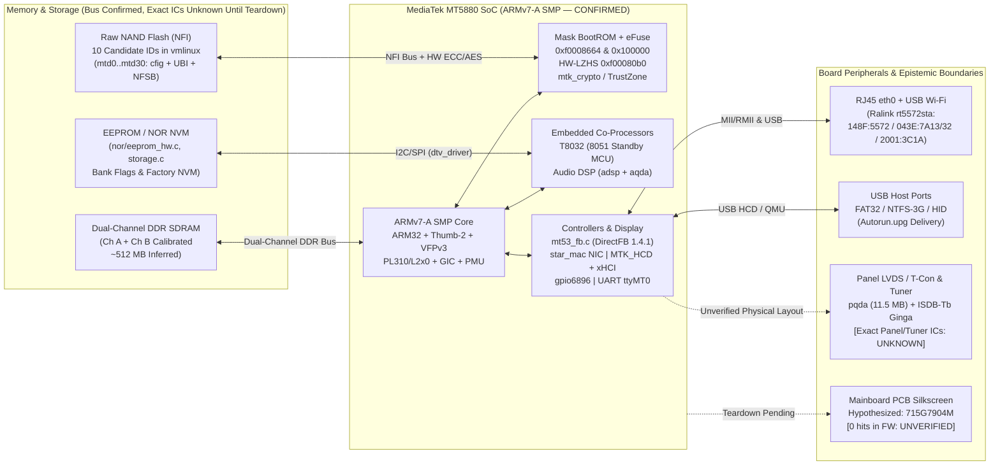

# Hardware Architecture Block Diagram (`AOC LE32S5760/20` / `MT5880`)

> **Scalar Vector Diagram:** [diagrams/HARDWARE_ARCHITECTURE.svg](../diagrams/HARDWARE_ARCHITECTURE.svg)  
> **Component Evidence Matrix:** [HARDWARE_COMPONENT_INVENTORY.csv](HARDWARE_COMPONENT_INVENTORY.csv)

## 1. Interactive Mermaid Architecture View

## 2. Node-to-Artifact Traceability Summary

- **Solid nodes** correspond to subsystems backed by disassembled machine instructions (`uboot.bin`, `vmlinux.bin`), module `.modinfo` metadata (`KERNEL_MODULE_INVENTORY.csv`), or `cfig` PKG tables (`FIRMWARE_METADATA.json`).
- **Dashed boundaries** (`PANEL`, `PCB`) explicitly flag hardware attributes requiring visual photography in [HARDWARE_PHOTOGRAPHIC_DOCUMENTATION/](HARDWARE_PHOTOGRAPHIC_DOCUMENTATION/README.md).
