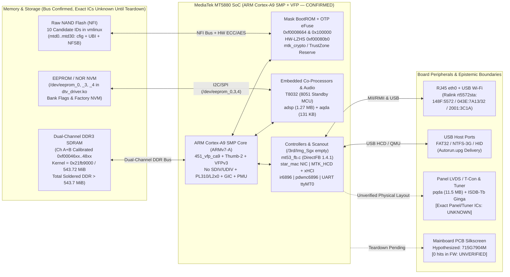

# Hardware Architecture Block Diagram (`AOC LE32S5760/20` / `MT5880`)

> **Scalar Vector Diagram:** [diagrams/HARDWARE_ARCHITECTURE.svg](../diagrams/HARDWARE_ARCHITECTURE.svg)  
> **Component Evidence Matrix:** [HARDWARE_COMPONENT_INVENTORY.csv](HARDWARE_COMPONENT_INVENTORY.csv)

## 1. Interactive Mermaid Architecture View

## 2. Node-to-Artifact Traceability & Measurement Revision History

- **Solid nodes** correspond to subsystems backed directly by disassembled instructions (`uboot.bin`, `vmlinux.bin`), unstripped `uenv` `.data`/`.ARM.attributes` DWARF symbols (`global_kernel_dram_size = 0x21fb9000`), `DT_RPATH` compiler provenance (`451_vfp_ca9`), module `.modinfo` metadata (`KERNEL_MODULE_INVENTORY.csv`), or `cfig` PKG tables (`FIRMWARE_METADATA.json`).
- **DRAM Estimate Refinement (`~512 MB` -> `> 543.7 MiB`):** Initial high-level documentation inferred `~512 MB` from early 2014 TV class sizing. Subsequent extraction of `uenv` `.data` (`env.c`, `global_kernel_dram_size = 0x21fb9000` = `570,134,528` B = `543.72 MiB`) superseded that approximation, proving soldered DRAM is strictly larger than `543.72 MiB` once `mt53xx_get_reserved_area` DMA/video/TrustZone buffers are included ([MEMORY_ARCHITECTURE.md](MEMORY_ARCHITECTURE.md)).
- **Dashed boundaries** (`PANEL`, `PCB`) explicitly flag hardware attributes requiring visual photography in [HARDWARE_PHOTOGRAPHIC_DOCUMENTATION/](HARDWARE_PHOTOGRAPHIC_DOCUMENTATION/README.md).
